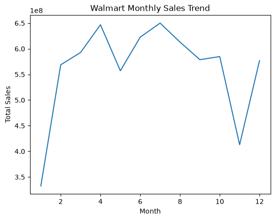
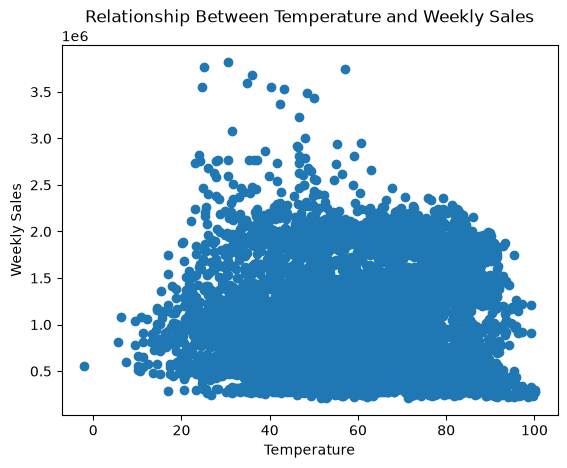
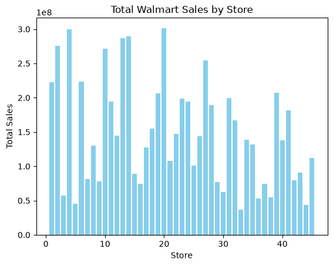
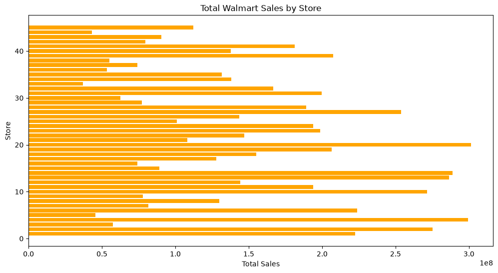
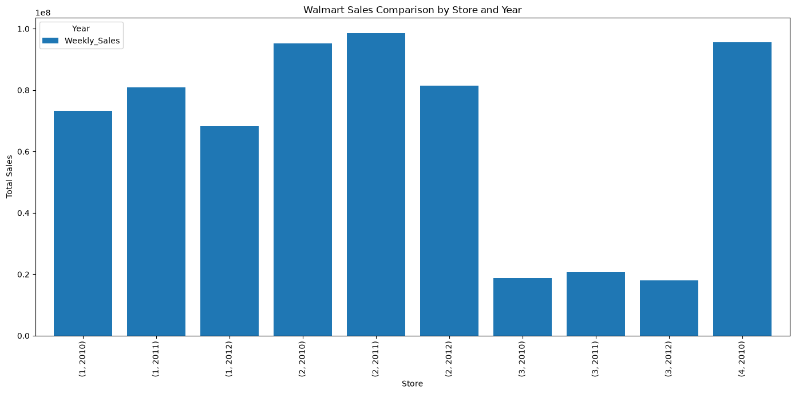
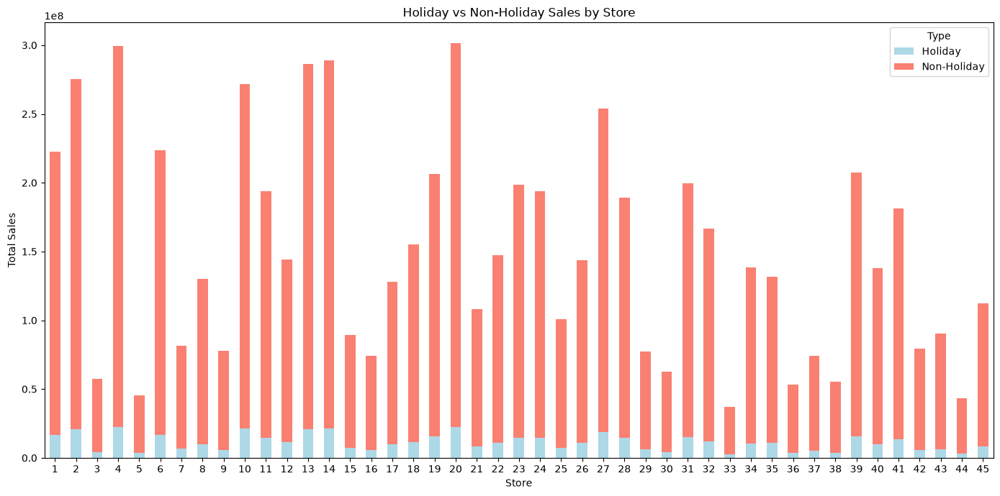
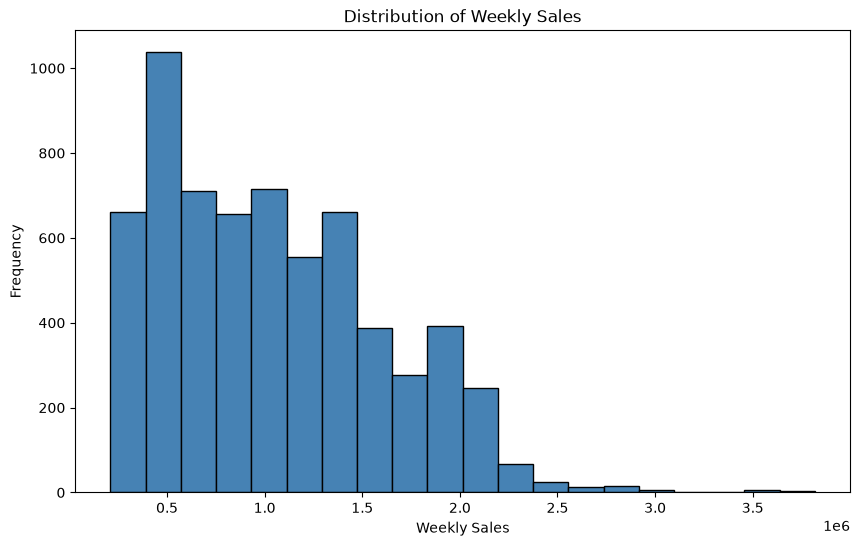
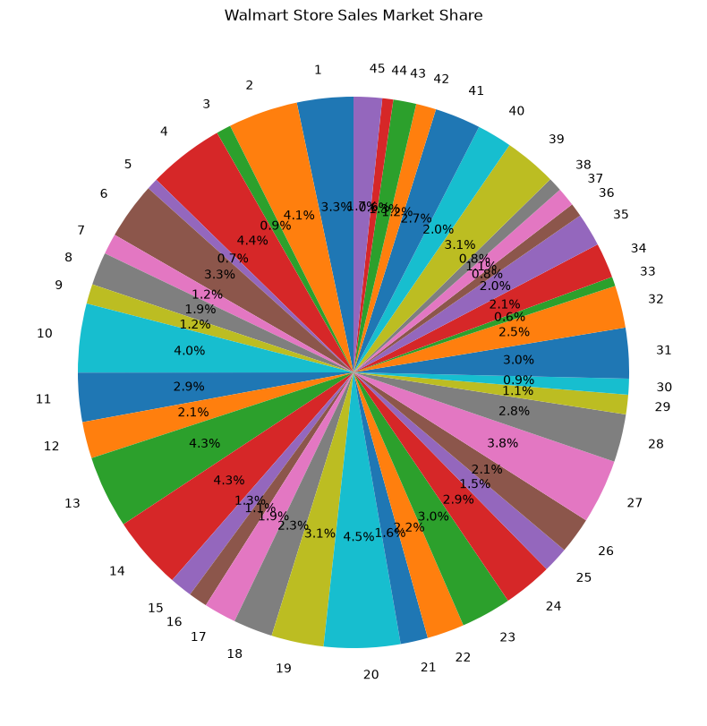

# Assignment 11: Matplotlib
## How to Run

### Option 1: Jupyter Notebook

1. Clone or download the repository.
2. Open a terminal in the project folder.
3. Install Jupyter Notebook if not already installed:

```bash
pip install notebook
```

4. Start Jupyter Notebook:

```bash
jupyter notebook
```

5. Open `Matplotlib.ipynb`.
6. Run the cells one by one using:
   - **Shift + Enter**, or
   - **Run → Run All Cells**
### Option 2: VS Code

1. Open the project folder in VS Code.
2. Install the **Python** and **Jupyter** extensions.
3. Open the `.ipynb` file.
4. Click **Run All** or execute cells individually.
## Task 1: Line Plot (Sales Trend)


```python
import pandas as pd
import matplotlib.pyplot as plt


```


```python
# crate data frame using kaggle walmart dataset
df=pd.read_csv("dataset_file/Walmart_Sales.csv")
print(df)
```

          Store        Date  Weekly_Sales  Holiday_Flag  Temperature  Fuel_Price  \
    0         1  05-02-2010    1643690.90             0        42.31       2.572   
    1         1  12-02-2010    1641957.44             1        38.51       2.548   
    2         1  19-02-2010    1611968.17             0        39.93       2.514   
    3         1  26-02-2010    1409727.59             0        46.63       2.561   
    4         1  05-03-2010    1554806.68             0        46.50       2.625   
    ...     ...         ...           ...           ...          ...         ...   
    6430     45  28-09-2012     713173.95             0        64.88       3.997   
    6431     45  05-10-2012     733455.07             0        64.89       3.985   
    6432     45  12-10-2012     734464.36             0        54.47       4.000   
    6433     45  19-10-2012     718125.53             0        56.47       3.969   
    6434     45  26-10-2012     760281.43             0        58.85       3.882   
    
                 CPI  Unemployment  
    0     211.096358         8.106  
    1     211.242170         8.106  
    2     211.289143         8.106  
    3     211.319643         8.106  
    4     211.350143         8.106  
    ...          ...           ...  
    6430  192.013558         8.684  
    6431  192.170412         8.667  
    6432  192.327265         8.667  
    6433  192.330854         8.667  
    6434  192.308899         8.667  
    
    [6435 rows x 8 columns]
    


```python
df["Date"] = pd.to_datetime(df["Date"], format="%d-%m-%Y")
# Extract month number
df["Month"] = df["Date"].dt.month

# Calculate total sales for each month
monthly_sales = df.groupby("Month")["Weekly_Sales"].sum()

# Create line plot
plt.plot(monthly_sales.index, monthly_sales.values)

# Add title
plt.title("Walmart Monthly Sales Trend")

# Add X-axis label
plt.xlabel("Month")

# Add Y-axis label
plt.ylabel("Total Sales")

```


    Text(0, 0.5, 'Total Sales')


    

    


```python
## Task 2: Scatter Plot

plt.scatter(df["Temperature"],df["Weekly_Sales"])
# Add title
plt.title("Relationship Between Temperature and Weekly Sales")

# Add X-axis label
plt.xlabel("Temperature")

# Add Y-axis label
plt.ylabel("Weekly Sales")


```


    Text(0, 0.5, 'Weekly Sales')


    

    


```python
# Task 3: Bar Plot
## Total sales of each store
## Vertical Bar Chart
store_sales=df.groupby("Store")["Weekly_Sales"].sum()
plt.Figure(figsize=(12,6))
plt.bar(store_sales.index,store_sales.values,color="skyblue")
plt.title("Total Walmart Sales by Store")
plt.xlabel("Store")
plt.ylabel("Total Sales")

```


    Text(0, 0.5, 'Total Sales')


    

    


```python
# Horizontal Chart
plt.figure(figsize=(12, 6))
plt.barh(store_sales.index, store_sales.values, color="orange")

plt.title("Total Walmart Sales by Store")
plt.xlabel("Total Sales")
plt.ylabel("Store")
```


    Text(0, 0.5, 'Store')


    

    


```python
# Task 4: Multiple Bar Plot
df["Date"] = pd.to_datetime(df["Date"], dayfirst=True)
df["Year"] = df["Date"].dt.year
yearly_sales = df.groupby(["Store", "Year"])["Weekly_Sales"].sum()

print(yearly_sales)

```

    Store  Year
    1      2010    73278832.00
           2011    80921918.83
           2012    68202058.02
    2      2010    95277864.19
           2011    98607881.42
                      ...     
    44     2011    15498194.67
           2012    14187373.72
    45     2010    38536343.37
           2011    41135367.88
           2012    32723630.17
    Name: Weekly_Sales, Length: 135, dtype: float64
    


```python
# Multiple bar chart
less_data=yearly_sales.head(10)
ax = less_data.plot(
    kind="bar",
    figsize=(14, 7),
    width=0.8
)

plt.title("Walmart Sales Comparison by Store and Year")
plt.xlabel("Store")
plt.ylabel("Total Sales")
plt.legend(title="Year")

plt.xticks(rotation=90)
plt.tight_layout()
plt.show()
```


    

    


```python
## Task 5: Stacked Bar chart:
df["Holiday_Type"] = df["Holiday_Flag"].map({
    0: "Non-Holiday",
    1: "Holiday"
})

holiday_sales = df.groupby(
    ["Store", "Holiday_Type"]
)["Weekly_Sales"].sum().unstack(fill_value=0)
print(holiday_sales)

```

    Holiday_Type      Holiday   Non-Holiday
    Store                                  
    1             16657476.56  2.057453e+08
    2             20792669.00  2.545898e+08
    3              4378110.50  5.320862e+07
    4             22431026.24  2.771129e+08
    5              3595016.07  4.188067e+07
    6             16809079.27  2.069471e+08
    7              6724002.65  7.487427e+07
    8              9753308.60  1.201979e+08
    9              5889508.21  7.189971e+07
    10            21137559.49  2.504802e+08
    11            14483944.85  1.794788e+08
    12            11381404.20  1.329058e+08
    13            21130438.06  2.653873e+08
    14            21205829.98  2.677941e+08
    15             7064060.18  8.206962e+07
    16             5667336.46  6.858509e+07
    17             9797969.71  1.179842e+08
    18            11694221.61  1.434205e+08
    19            15770467.34  1.908644e+08
    20            22490350.81  2.789074e+08
    21             8264913.09  9.985297e+07
    22            10848746.56  1.362269e+08
    23            14625422.94  1.841252e+08
    24            14750982.51  1.792650e+08
    25             7396768.42  9.366441e+07
    26            10720468.49  1.326959e+08
    27            18922992.78  2.349329e+08
    28            14782446.05  1.744812e+08
    29             6069578.89  7.107198e+07
    30             4368593.07  5.834829e+07
    31            15000260.30  1.846136e+08
    32            12037840.83  1.547814e+08
    33             2625945.19  3.453428e+07
    34            10419780.89  1.278300e+08
    35            10743484.57  1.207772e+08
    36             3676406.30  4.973581e+07
    37             5075250.50  6.912749e+07
    38             3815098.78  5.134453e+07
    39            15511274.80  1.919343e+08
    40            10080340.75  1.277900e+08
    41            13349478.56  1.679925e+08
    42             5676941.58  7.388881e+07
    43             6359462.78  8.420597e+07
    44             2960356.01  4.033273e+07
    45             8362937.13  1.040324e+08
    


```python

holiday_sales.plot(
    kind="bar",
    stacked=True,
    figsize=(14, 7),
    color=["lightblue", "salmon"]
)

plt.title("Holiday vs Non-Holiday Sales by Store")
plt.xlabel("Store")
plt.ylabel("Total Sales")
plt.legend(title="Type")
plt.xticks(rotation=0)
plt.tight_layout()

```


    

    


```python
## Task 6: Histogram
plt.figure(figsize=(10, 6))

plt.hist(
    df["Weekly_Sales"],
    bins=20,
    color="steelblue",
    edgecolor="black"
)

plt.title("Distribution of Weekly Sales")
plt.xlabel("Weekly Sales")
plt.ylabel("Frequency")

```


    Text(0, 0.5, 'Frequency')


    

    


```python
## Task 7: Pie Chart
plt.figure(figsize=(10, 10))

plt.pie(
    store_sales,
    labels=store_sales.index,
    autopct="%1.1f%%",
    startangle=90
)

plt.title("Walmart Store Sales Market Share")
```


    Text(0.5, 1.0, 'Walmart Store Sales Market Share')


    

    


```python

```
