# Assignment 12: Seaborn

## Task 1: Relational Plot


```python
pip install seaborn
```


```python
import pandas as pd
import seaborn as sns
import matplotlib.pyplot as plt
```


```python
df=pd.read_csv("dataset/StudentPerformanceFactors.csv")
print(df)
```

          Hours_Studied  Attendance Parental_Involvement Access_to_Resources  \
    0                23          84                  Low                High   
    1                19          64                  Low              Medium   
    2                24          98               Medium              Medium   
    3                29          89                  Low              Medium   
    4                19          92               Medium              Medium   
    ...             ...         ...                  ...                 ...   
    6602             25          69                 High              Medium   
    6603             23          76                 High              Medium   
    6604             20          90               Medium                 Low   
    6605             10          86                 High                High   
    6606             15          67               Medium                 Low   
    
         Extracurricular_Activities  Sleep_Hours  Previous_Scores  \
    0                            No            7               73   
    1                            No            8               59   
    2                           Yes            7               91   
    3                           Yes            8               98   
    4                           Yes            6               65   
    ...                         ...          ...              ...   
    6602                         No            7               76   
    6603                         No            8               81   
    6604                        Yes            6               65   
    6605                        Yes            6               91   
    6606                        Yes            9               94   
    
         Motivation_Level Internet_Access  Tutoring_Sessions Family_Income  \
    0                 Low             Yes                  0           Low   
    1                 Low             Yes                  2        Medium   
    2              Medium             Yes                  2        Medium   
    3              Medium             Yes                  1        Medium   
    4              Medium             Yes                  3        Medium   
    ...               ...             ...                ...           ...   
    6602           Medium             Yes                  1          High   
    6603           Medium             Yes                  3           Low   
    6604              Low             Yes                  3           Low   
    6605             High             Yes                  2           Low   
    6606           Medium             Yes                  0        Medium   
    
         Teacher_Quality School_Type Peer_Influence  Physical_Activity  \
    0             Medium      Public       Positive                  3   
    1             Medium      Public       Negative                  4   
    2             Medium      Public        Neutral                  4   
    3             Medium      Public       Negative                  4   
    4               High      Public        Neutral                  4   
    ...              ...         ...            ...                ...   
    6602          Medium      Public       Positive                  2   
    6603            High      Public       Positive                  2   
    6604          Medium      Public       Negative                  2   
    6605          Medium     Private       Positive                  3   
    6606          Medium      Public       Positive                  4   
    
         Learning_Disabilities Parental_Education_Level Distance_from_Home  \
    0                       No              High School               Near   
    1                       No                  College           Moderate   
    2                       No             Postgraduate               Near   
    3                       No              High School           Moderate   
    4                       No                  College               Near   
    ...                    ...                      ...                ...   
    6602                    No              High School               Near   
    6603                    No              High School               Near   
    6604                    No             Postgraduate               Near   
    6605                    No              High School                Far   
    6606                    No             Postgraduate               Near   
    
          Gender  Exam_Score  
    0       Male          67  
    1     Female          61  
    2       Male          74  
    3       Male          71  
    4     Female          70  
    ...      ...         ...  
    6602  Female          68  
    6603  Female          69  
    6604  Female          68  
    6605  Female          68  
    6606    Male          64  
    
    [6607 rows x 20 columns]
    


```python
df.head()
```


<div>
<style scoped>
    .dataframe tbody tr th:only-of-type {
        vertical-align: middle;
    }

    .dataframe tbody tr th {
        vertical-align: top;
    }

    .dataframe thead th {
        text-align: right;
    }
</style>
<table border="1" class="dataframe">
  <thead>
    <tr style="text-align: right;">
      <th></th>
      <th>Hours_Studied</th>
      <th>Attendance</th>
      <th>Parental_Involvement</th>
      <th>Access_to_Resources</th>
      <th>Extracurricular_Activities</th>
      <th>Sleep_Hours</th>
      <th>Previous_Scores</th>
      <th>Motivation_Level</th>
      <th>Internet_Access</th>
      <th>Tutoring_Sessions</th>
      <th>Family_Income</th>
      <th>Teacher_Quality</th>
      <th>School_Type</th>
      <th>Peer_Influence</th>
      <th>Physical_Activity</th>
      <th>Learning_Disabilities</th>
      <th>Parental_Education_Level</th>
      <th>Distance_from_Home</th>
      <th>Gender</th>
      <th>Exam_Score</th>
    </tr>
  </thead>
  <tbody>
    <tr>
      <th>0</th>
      <td>23</td>
      <td>84</td>
      <td>Low</td>
      <td>High</td>
      <td>No</td>
      <td>7</td>
      <td>73</td>
      <td>Low</td>
      <td>Yes</td>
      <td>0</td>
      <td>Low</td>
      <td>Medium</td>
      <td>Public</td>
      <td>Positive</td>
      <td>3</td>
      <td>No</td>
      <td>High School</td>
      <td>Near</td>
      <td>Male</td>
      <td>67</td>
    </tr>
    <tr>
      <th>1</th>
      <td>19</td>
      <td>64</td>
      <td>Low</td>
      <td>Medium</td>
      <td>No</td>
      <td>8</td>
      <td>59</td>
      <td>Low</td>
      <td>Yes</td>
      <td>2</td>
      <td>Medium</td>
      <td>Medium</td>
      <td>Public</td>
      <td>Negative</td>
      <td>4</td>
      <td>No</td>
      <td>College</td>
      <td>Moderate</td>
      <td>Female</td>
      <td>61</td>
    </tr>
    <tr>
      <th>2</th>
      <td>24</td>
      <td>98</td>
      <td>Medium</td>
      <td>Medium</td>
      <td>Yes</td>
      <td>7</td>
      <td>91</td>
      <td>Medium</td>
      <td>Yes</td>
      <td>2</td>
      <td>Medium</td>
      <td>Medium</td>
      <td>Public</td>
      <td>Neutral</td>
      <td>4</td>
      <td>No</td>
      <td>Postgraduate</td>
      <td>Near</td>
      <td>Male</td>
      <td>74</td>
    </tr>
    <tr>
      <th>3</th>
      <td>29</td>
      <td>89</td>
      <td>Low</td>
      <td>Medium</td>
      <td>Yes</td>
      <td>8</td>
      <td>98</td>
      <td>Medium</td>
      <td>Yes</td>
      <td>1</td>
      <td>Medium</td>
      <td>Medium</td>
      <td>Public</td>
      <td>Negative</td>
      <td>4</td>
      <td>No</td>
      <td>High School</td>
      <td>Moderate</td>
      <td>Male</td>
      <td>71</td>
    </tr>
    <tr>
      <th>4</th>
      <td>19</td>
      <td>92</td>
      <td>Medium</td>
      <td>Medium</td>
      <td>Yes</td>
      <td>6</td>
      <td>65</td>
      <td>Medium</td>
      <td>Yes</td>
      <td>3</td>
      <td>Medium</td>
      <td>High</td>
      <td>Public</td>
      <td>Neutral</td>
      <td>4</td>
      <td>No</td>
      <td>College</td>
      <td>Near</td>
      <td>Female</td>
      <td>70</td>
    </tr>
  </tbody>
</table>
</div>


```python
print(df.columns.tolist())
```

    ['Hours_Studied', 'Attendance', 'Parental_Involvement', 'Access_to_Resources', 'Extracurricular_Activities', 'Sleep_Hours', 'Previous_Scores', 'Motivation_Level', 'Internet_Access', 'Tutoring_Sessions', 'Family_Income', 'Teacher_Quality', 'School_Type', 'Peer_Influence', 'Physical_Activity', 'Learning_Disabilities', 'Parental_Education_Level', 'Distance_from_Home', 'Gender', 'Exam_Score']
    


```python
# 1. create a relational plot
sns.relplot(
    data=df,
    x="Exam_Score",
    y="Hours_Studied",
    hue="Gender",
  
)

plt.show()
```


    
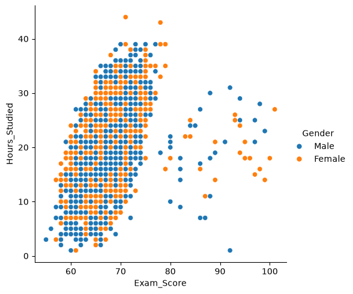
    


```python
# 2.use hue with a categorical column
sns.relplot(
    data=df,
    x="Exam_Score",
    y="Hours_Studied",
    hue="Family_Income",
)

plt.show()
```


    
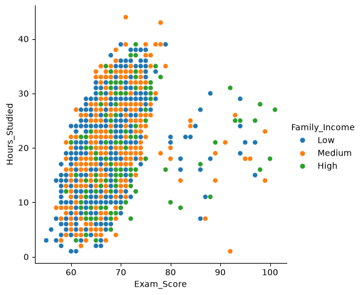
    


```python
# 3. create the same plot using scatter style
sns.relplot(
    data=df,
    x="Exam_Score",
    y="Hours_Studied",
    hue="Family_Income",
    kind="scatter"
)

plt.show()
```


    

    


## Task 2: Line Plot as Scatter & Facet


```python
# 1. Create a line plot using sns.lineplot()
sns.lineplot( 
    data=df,
    x="Exam_Score",
    y="Previous_Scores",
    hue="Gender"
)
plt.title("Previous Score vs Exam Score")
```


    Text(0.5, 1.0, 'Previous Score vs Exam Score')


    
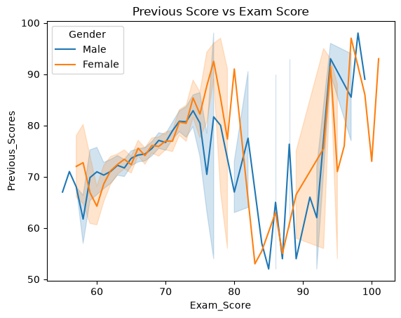
    


```python
# 2. convert the same relationship into a scatter-style line plot
sns.relplot( 
    data=df,
    x="Exam_Score",
    y="Previous_Scores",
    hue="Gender",
    kind="scatter"
)
plt.title("Previous Score vs Exam Score")
```


    Text(0.5, 1.0, 'Previous Score vs Exam Score')


    
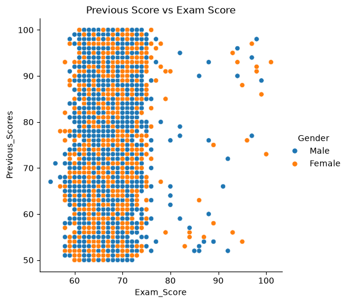
    


```python
# 3. use faceting (col or row) to split the plot based on a categorical column
sns.relplot( 
    data=df,
    x="Exam_Score",
    y="Previous_Scores",
    hue="Gender",
    col="Family_Income",
    kind="scatter"

)
plt.title("Previous Score vs Exam Score")
```


    Text(0.5, 1.0, 'Previous Score vs Exam Score')


    
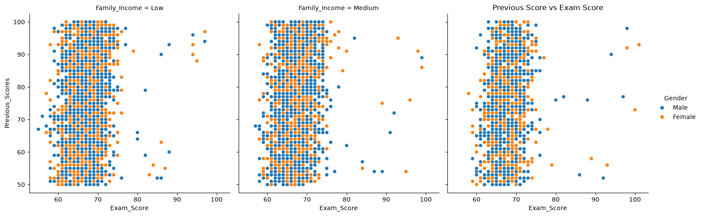
    


## Task 3: Distribution Plots


```python
# 1. Plot histogram using seaborn

sns.histplot(
    data=df,
    x="Exam_Score",
    bins=10
)

plt.title("Distribution of Exam Scores")
plt.show()
```


    
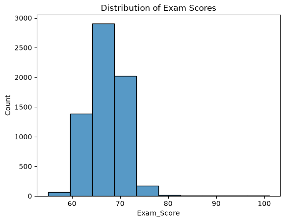
    


```python
# 2. Plot KDE Plot

sns.kdeplot(
    data=df,
    x="Exam_Score",
    fill=True
)

plt.title("KDE Plot of Exam Scores")
plt.show()
```


    
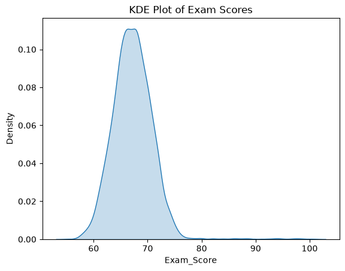
    


```python
# 3. Plot Rug Plot
sns.rugplot(
    data=df,
    x="Exam_Score"
)

plt.title("Rug Plot of Exam Scores")
plt.show()
```


    
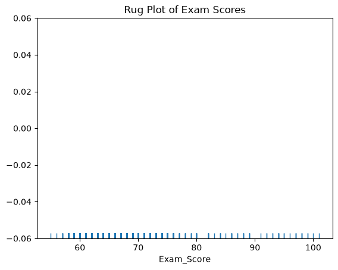
    


```python
# 4. Combine Histogram+KDE in a single plot
sns.histplot(
    data=df,
    x="Exam_Score",
    bins=10,
    kde=True
)

plt.title("Histogram and KDE of Exam Scores")
plt.show()
```


    
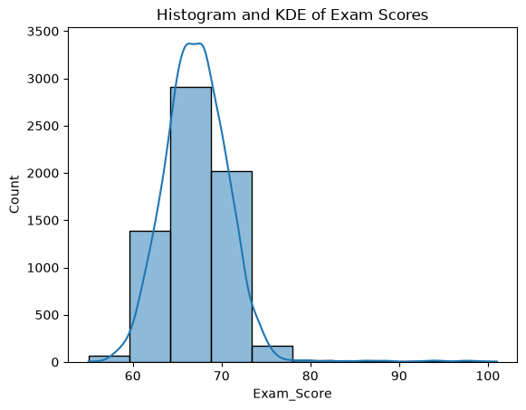
    


## Task 4: Bivariate Distribution Plots


```python
# 1. Create a bivariate histogram
sns.histplot(
    data=df,
    x="Exam_Score",
    y="Hours_Studied",
    bins=15,
    cbar=True
)

plt.title("Bivariate Histogram: Exam vs Hours Studied")
plt.show()
```


    
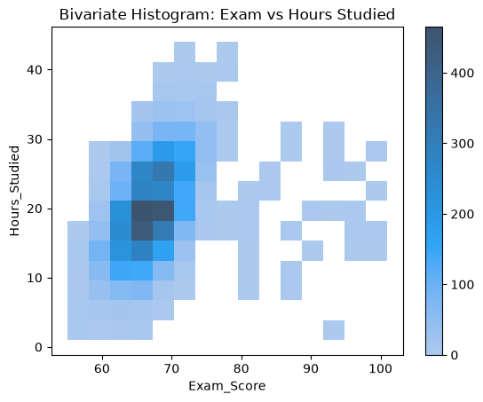
    


```python
# 2. Create a bivariate KDE plot
sns.kdeplot(
    data=df,
    x="Exam_Score",
    y="Hours_Studied",
    fill=True,
    cmap="Blues"
)

plt.title("Bivariate KDE: Exam vs Hours Studied")
plt.show()
```


    
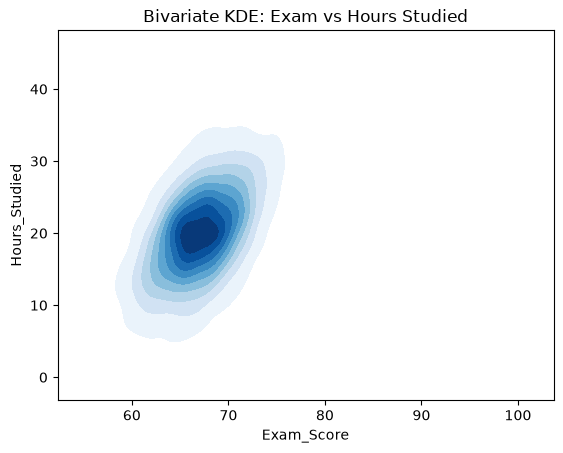
    


## Task 5: Matrix Plots


```python
# 1. Create a pair plot using sns.pairplot()
sns.pairplot(
    df,
    vars=["Previous_Scores", "Exam_Score"],
    diag_kind="hist"
)

plt.show()
```


    
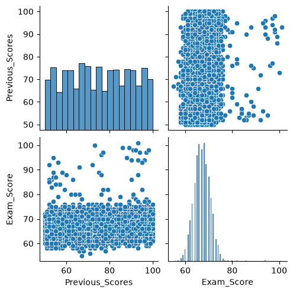
    


```python
# 2. create a heatmap of correlation matrix
correlation_matrix = df[["Previous_Scores", "Exam_Score"]].corr()

plt.figure(figsize=(6, 4))

sns.heatmap(
    correlation_matrix,
    annot=True,
    cmap="coolwarm",
    fmt=".2f",
    vmin=-1,
    vmax=1
)

plt.title("Correlation Matrix Heatmap")
plt.show()
```


    
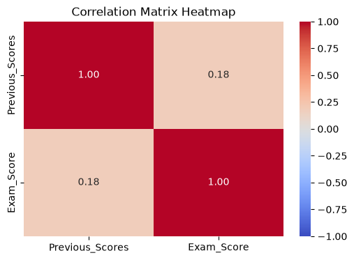
    


## Task 6: Categorical Plots


```python
# 1. Bar Plot
plt.figure(figsize=(8, 5))

sns.barplot(
    data=df,
    x="Gender",
    y="Exam_Score",
    errorbar=None
)

plt.title("Average Score by Gender")
plt.xticks(rotation=45)
plt.show()
```


    
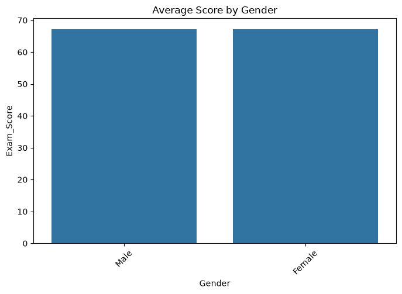
    


```python
# 2. Box Plot
plt.figure(figsize=(8, 5))

sns.boxplot(
    data=df,
    x="Gender",
    y="Exam_Score"
)

plt.title("Marks Distribution by Gender")
plt.xticks(rotation=45)
plt.show()
```


    
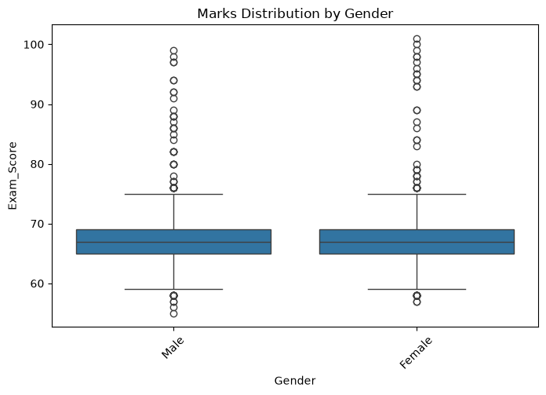
    


```python
# 3. Violin plot

plt.figure(figsize=(8, 5))

sns.violinplot(
    data=df,
    x="Gender",
    y="Exam_Score"
)

plt.title("Marks Distribution by Gender")
plt.xticks(rotation=45)
plt.show()
```


    
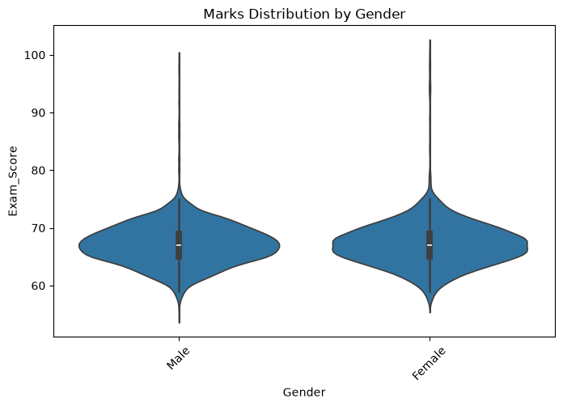
    


```python
# 4. Count Plot
plt.figure(figsize=(8, 5))

sns.countplot(
    data=df,
    x="Gender"
)

plt.title("Number of Student by Gender")
plt.xticks(rotation=45)
plt.show()

```


    
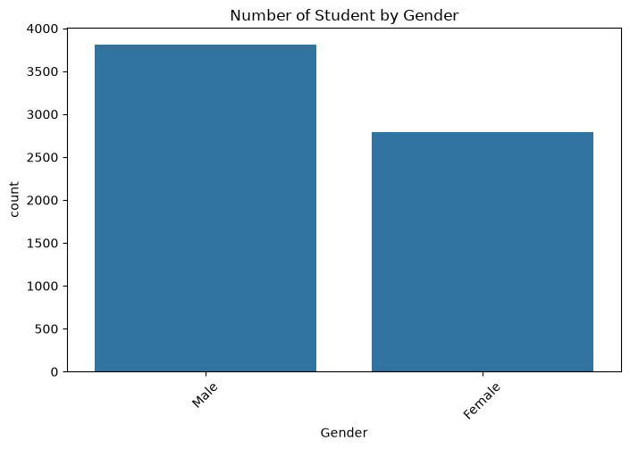
    


## Task 7. Regression Plots


```python
# 1. Create a regression plot(regplot) between two numerical column
plt.figure(figsize=(8, 5))

sns.regplot(
    data=df,
    x="Attendance",
    y="Sleep_Hours",
    scatter_kws={"alpha": 0.6},
    line_kws={"color": "red"}
)

plt.title("Regression Plot: Attendance vs Sleep Hours")
plt.show()
```


    
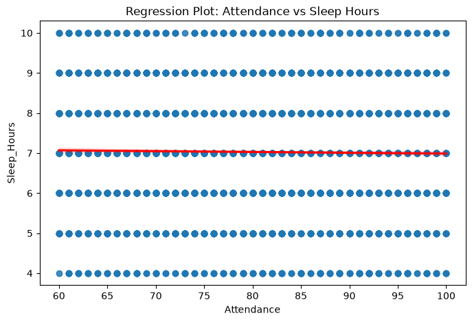
    


```python
# 2. create an implot with hue using a categorical column
sns.lmplot(
    data=df,
    x="Attendance",
    y="Sleep_Hours",
    hue="Gender",
    height=5,
    aspect=1.4
)

plt.title("Regression Plot by Gender")
plt.show()
```


    
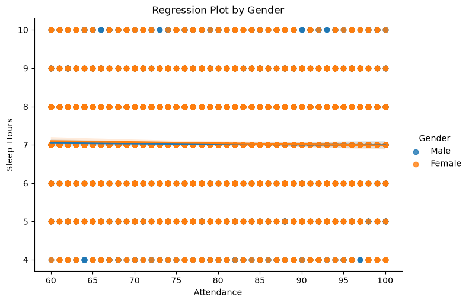
    


## Task 8: Multi Plots & figure level plots


```python
# 1. Create a FacetGrid
g = sns.FacetGrid(
    data=df,
    col="Gender",
    height=4
)

g.map_dataframe(
    sns.scatterplot,
    x="Attendance",
    y="Exam_Score"
)

g.set_axis_labels("Attendance", "Exam_Score")
g.fig.suptitle("Student Attendance vs Score by Gender", y=1.05)

```


    Text(0.5, 1.05, 'Student Attendance vs Score by Gender')


    
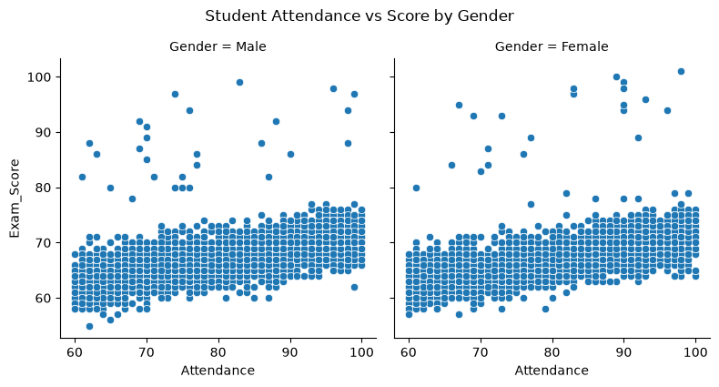
    


```python
# 1. Create a multi plot dashboard: relplot
sns.relplot(
    data=df,
    x="Attendance",
    y="Exam_Score",
    hue="Gender",
    kind="scatter"
)

```


    <seaborn.axisgrid.FacetGrid at 0x19c05998410>


    
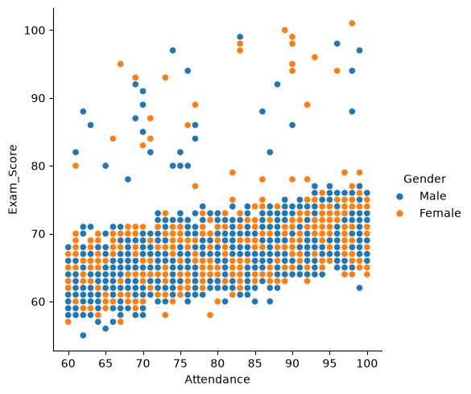
    


```python
# catplot:
sns.catplot(
    data=df,
    x="School_Type",
    y="Exam_Score",
    hue="Gender",
    kind="box"
)
```


    <seaborn.axisgrid.FacetGrid at 0x19c05998a50>


    
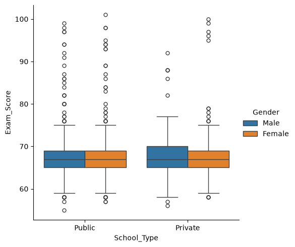
    


```python
# displot:
sns.displot(
    data=df,
    x="Exam_Score",
    hue="Gender",
    kind="hist",
    kde=True
)
```


    <seaborn.axisgrid.FacetGrid at 0x19c05973ed0>


    
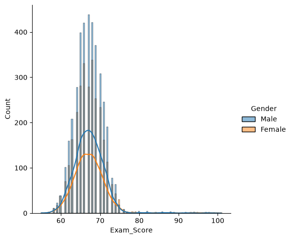
    


```python

```
